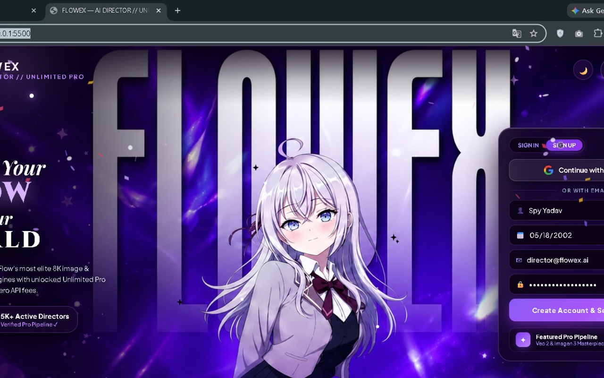

  

<h1 align="center">FlowEx — Your Agent, Connected to Google Flow</h1>

  <strong>Plug your AI agent straight into Google Flow — and create without limits.</strong> 
  Unlimited images. Cinematic videos. Ultra-speed generations. Download everything — free.

  <a href="https://flowex-studio.vercel.app/"><strong>🌐 Website</strong></a> •
  <a href="#-download--install"><strong>⬇️ Download</strong></a> •
  <a href="https://flowex-studio.vercel.app/privacy"><strong>🔒 Privacy Policy</strong></a>

---

## ⚡ Why FlowEx?

- 🤖 **Agent-Connected** — your coding agent plugs directly into Google Flow and directs it for you
- 🎬 **UNLIMITED Creations** — images & cinematic videos, no FlowEx caps, no paywalls
- 🚀 **Ultra-Speed Generations** — prompt to render in seconds, not minutes
- ⬇️ **Free Unlimited Downloads** — every creation is yours to keep, forever
- 🔐 **1-Click Google Sign-In** — official OAuth. No API keys. No extra passwords. No fees.

## ✨ How It Works

FlowEx is a Chrome extension + director dashboard that connects your **coding agent** to **Google Flow** through a local bridge on your own machine (port 8791). Sign in with Google once — then just describe what you want, and watch Flow's most elite image & video engines create it.

**Define Your FLOW. Own Your WORLD.**

## ⬇️ Download & Install

1. Download **`flowex-extension-v1.2.9.zip`** from the [latest release](../../releases/latest) (or from this repo's main page).
2. Unzip it — you will get a folder containing `manifest.json`.
3. Open Chrome and go to `chrome://extensions`.
4. Turn ON **Developer mode** (top-right).
5. Click **Load unpacked** and select the unzipped folder.
6. Click the FlowEx icon, open the dashboard, and **Continue with Google**. 🎬

## 🖼️ Screenshots

  

  

## 🔒 Privacy

FlowEx uses Google sign-in only to show your name, email and profile picture in your own dashboard. The bridge runs locally on your machine. Full policy: https://flowex-studio.vercel.app/privacy

## 🛟 Support

- Website: https://flowex-studio.vercel.app/
- Email: shivprakash6699@gmail.com

---

FLOWEX STUDIO // GOOGLE FLOW UNLIMITED PRO — Created by SPY Yadav

